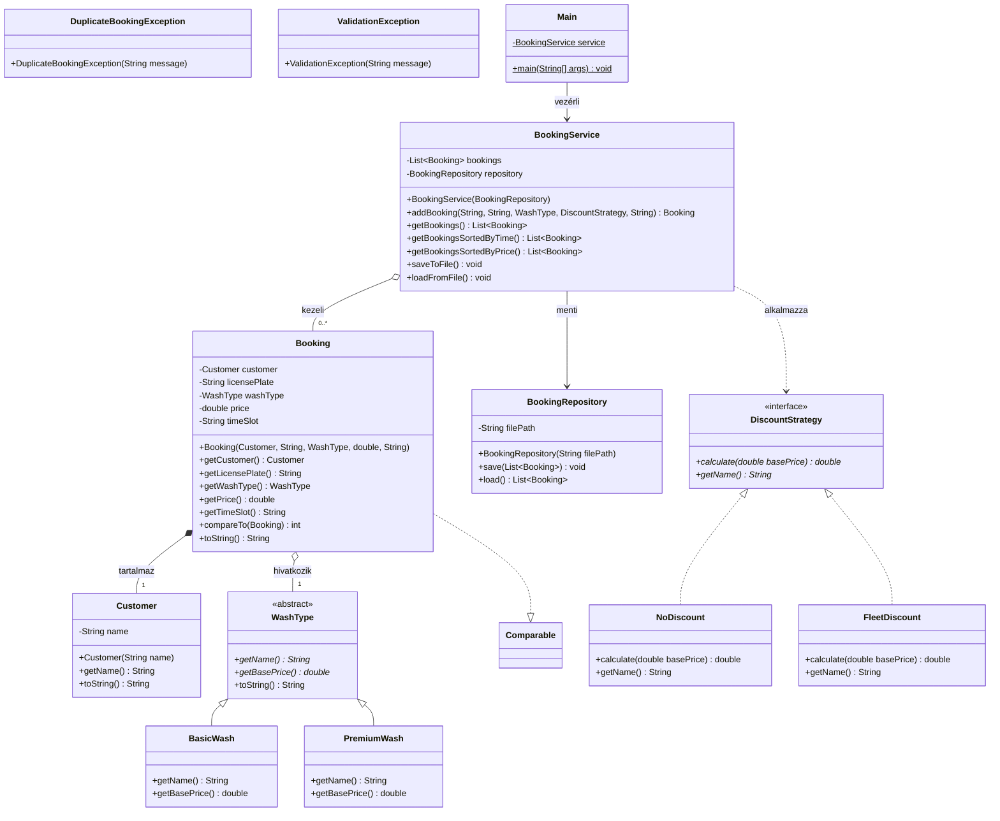

# Rendszerterv és UML Dokumentáció

## 1. Problémafelvetés (Problem Statement)
* **Célcsoport:** Kis- és közepes autómosók vezetői, recepciósai és pénztárosai.
* **Célkitűzés:** A járműmosási időpontok, csomagtípusok és flottakedvezmények gyors, áttekinthető kezelése konzolos felületen, valamint az adatok tartós tárolása.
* **Megoldott probléma:** Megszünteti a papíralapú vagy egyszerű táblázatos nyilvántartás hibáit: nem enged időpont-ütközéseket (duplikációkat), dinamikusan számolja az árakat a választott mosási típus és kedvezménystratégia alapján, valamint megbízhatóan menti és visszatölti az állapotot munkamenetek között.

---

## 2. UML Osztálydiagram (Class Diagram)

A diagram alább közvetlenül megtekinthető (GitHub és GitLab által támogatott formátumban), a szerkeszthető forráskód pedig a [`docs/uml_diagram.puml`](file:///Users/zalma/Dokumentumok/Egyetem/Prog%202/carwash-manager/docs/uml_diagram.puml) fájlban érhető el.

---

## 3. Tervezési minta: Stratégia (Strategy Pattern)

* **Alkalmazott minta:** **Strategy (Stratégia) tervezési minta**
* **Résztvevő osztályok és interfészek:**
  - `DiscountStrategy` (Stratégia interfész): közös szerződést határoz meg a kedvezményszámításra (`calculate(double basePrice)`).
  - `NoDiscount` (Konkrét stratégia 1): nem ad kedvezményt, a teljes alapárat hagyja érvényben.
  - `FleetDiscount` (Konkrét stratégia 2): 20%-os flottakedvezményt biztosít a partnercégek járműveire.
  - `BookingService` (Kliens/Kontextus): a foglalás létrehozásakor a megadott stratégiát hívja meg az árképzéshez anélkül, hogy ismerné annak belső kalkulációját.
* **Előny a tervezésben:**
  - Nyílt-zárt elv (OCP): új kedvezménytípusok (pl. `WeekendDiscount`, `VipDiscount`, `CouponDiscount`) úgy adhatók hozzá a rendszerhez, hogy a meglévő üzleti logikát vagy a `Booking` osztályt nem kell módosítani.
  - Futásidejű viselkedésváltoztatás: a felhasználó választásától függően a megfelelő kalkulációs algoritmus lép érvénybe.

---

## 4. Tervezési döntések és ismert korlátok (Design Decisions & Limitations)

### Főbb tervezési döntések:
1. **Egyszerűségre törekvés:** A lehető legtisztább, felesleges függőségektől mentes kódbázis megvalósítása standard Java 17 nyelvi elemekkel.
2. **Rétegekre bontás (Separation of Concerns):** A modell (`carwash.model`), a perzisztencia (`carwash.persistence`), az üzleti logika (`carwash.service`), a kivételkezelés (`carwash.exception`) és a felhasználói felület (`carwash.ui`) szeparált csomagokban helyezkedik el.
3. **Erős egységbezárás és validáció:** Az osztályok mezői privátak (`private final`), a konstruktorok érvénytelen adatok (pl. üres név, üres rendszám, negatív ár) esetén azonnal `ValidationException`-t dobnak.
4. **Kettős rendezési képesség:** A foglalások időpont szerint a természetes rendezettséget követik (`Comparable<Booking>`), míg ár szerint lambda-kifejezéssel/komparátorral (`Comparator.comparingDouble`) rendezhetők.
5. **Erőforrás-kezelés:** A fájlkezelés automatikus erőforrás-kezeléssel (`try-with-resources`) valósul meg, elkerülve a memóriaszivárgást vagy nyitva maradt fájlleírókat.

### Ismert korlátok:
* Egyszerű konzolos beviteli felület (nincs grafikus GUI, ami a kiírás szerint opcionális).
* Egyetlen mosóállás időpont-ütközését kezeli (ugyanarra az időpontra egyetlen foglalás engedélyezett).
* A perzisztencia lokális szöveges fájlba (`bookings.txt`) történik relációs adatbázis helyett.
